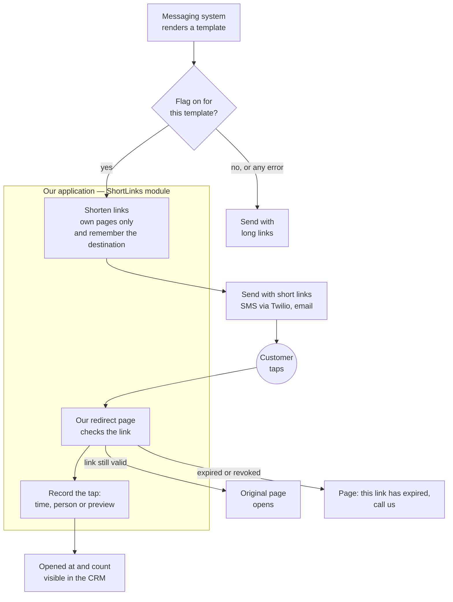

# Link shortener for outbound messages

**Proposal for the Call Center team** · Status: proposal · 8 November 2026 · Yurii Tsykvas
Audience: Call Center lead (all sections; section 6 and the hours table in section 8 are for engineering). Reading time: 10 minutes.

## 1. Summary

Our outbound text messages carry links to customer pages (quotes, e-sign, payment, documents). Those links are 80–150 characters long, which pushes almost every message into a second SMS segment that we pay for. A short branded link brings the message back to one segment, looks trustworthy, and — for the first time — tells us whether the customer opened it.

**Recommendation: build it as a small module inside our existing application**, not as a separate service and not as a subscription. Estimated **120–200 hours** of one engineer — **$4,800–8,000** at a $40/h contract rate (at a US in-house rate of $95–190/h multiply by 2–4; the Short.io alternative scales the same way) — plus **$8–130/year** in new infrastructure (the upper end only if our texting campaign needs re-registration), **3–5 weeks** of one full-time engineer to a live pilot, then 2–4 hours/month to keep it running. **Payback:** one to one and a half months at 20,000 messages/day; 1.2–2.4 years at 1,000/day, assuming one link per message — tell us your real daily volume and the share of messages that carry a link, that is the number that decides this. The alternative — Short.io at $1,776/year plus $3,600–6,400 of integration — costs about the same over three years; it loses on one point that matters for an insurer: every customer click would be stored by a third party for a year, and every link we have already sent would depend on that vendor staying up and keeping its price.

**How we will know it worked.** From day one of the pilot: segments and dollars per message, pilot templates vs. the rest. Also from day one, and for the first time ever: the share of links a customer actually opened.

**When the other choice wins.** If you and Compliance are comfortable with click data living at a vendor, and nobody wants to own this service at all, take Short.io — the integration work is the same and we would reuse it.

## 2. The problem

An SMS is billed per 160-character segment (153 when a message is split). A tokenised link to a customer page is 80–150 characters, so after the link only about 10–80 characters remain for the actual sentence — almost any wording tips the message into two segments. A branded short link such as `https://matic.link/Ab3dE9f2` is 27 characters and leaves about 130 for the text.

| | Per segment | Messages/day | Extra segments cost per year |
|---|---|---|---|
| Twilio US SMS $0.0083 + carrier fee $0.0035–0.0050 | **$0.0118–0.0133** | 1,000 | **$4,300–4,900** |
| | | 20,000 | **$86,000–97,000** |

Assumptions: one link per message; today the message needs two segments and with a short link needs one. The figures scale linearly with the share of messages that actually contain a link.

Beyond the invoice: a 150-character link full of random characters looks like the phishing messages customers are told to ignore; in email a long link is merely ugly, not expensive; and today we have **no idea** whether anyone opened what we sent — the message leaves and the story ends.

## 3. What we assume

**Working assumptions.** The application runs Rails 7 or newer; the agent CRM is part of the same application (so "opened at" is readable there directly); the messaging system — the pipeline that renders templates and sends them — keeps the message text before shortening; and our 10DLC registration (the carrier registration of our texting campaign) can be amended with the new domain, otherwise a new campaign takes up to five business days. If any of these turns out differently, the estimate in section 8 changes and we will say so before starting.

## 4. Options

### 4.1 Use an existing product: Short.io

We checked twenty products — SMS providers' built-in shortening, nine SaaS shorteners, nine open-source ones (prices read on 8 November 2026). One fits: **Short.io, Enterprise plan, $148/month**, the only published plan with no cap on API-created links at our volume. It offers batch creation, a per-click webhook, link expiry, a 99.9% SLA, SOC 2 Type II, a data-processing agreement and, on request, a HIPAA business associate agreement.

| Dimension | Assessment |
|---|---|
| What you get | Short branded links, "opened at", expiry, vendor dashboard |
| What you don't | Control over click data (IP addresses stored by the vendor for a year); independence from the vendor's pricing and uptime for links already sent; revocation only via their API |
| Cost | $1,776/year + $3,600–6,400 integration (90–160 h) + 1–2 h/month |
| Time to pilot | 3–5 weeks of engineering **+ 2–6 weeks of vendor onboarding** (security questionnaire, DPA/BAA) |
| Main risk | A price change or an outage at the vendor breaks every link in messages we have already sent |

The integration is not free: our messaging system still needs the same call-site work as the build option, plus a client for their API, a receiver for their click webhook (which has no published schema or signature), a local table mapping our messages to their links, and a reconciliation job. Roughly half of those hours are messaging-system work both options need; that is why the "buy" estimate is 90–160 hours, not a week.

**Ruled out, and why** (one line each):

- **Twilio Link Shortening** (built into our SMS provider): $0.015 per message — *more than the segment it saves* ($0.012–0.013). At 600,000 messages/month that is ≈$9,000/month. Works only inside Twilio sends (not email), links expire after a fixed 90 days, no revocation.
- **Bitly**: self-serve plans stop at 3,000 links/month; everything we need is "Enterprise, contact sales"; links can never be deleted or disabled.
- **Self-hosted open source (Shlink)**: a separate PHP service for a Rails team, an open critical security advisory with no fixed version listed, no batch API. It would save one or two days of code and cost a service to run forever.

### 4.2 Build it as a module in our application

Two database tables, one internal call for the messaging system, one public page that redirects, one nightly cleanup job. It runs on what we already have — PostgreSQL, background jobs, Kubernetes, Datadog, Sentry, feature flags, Twilio. The only new thing is a short domain (~$8/year).

| Dimension | Assessment |
|---|---|
| What you get | Everything in 4.1, plus: click data stays with us (and we store less of it — no IP addresses), links can be revoked, no per-link limits, no subscription |
| What you don't | A vendor's analytics dashboard; someone else to blame when the redirect is down |
| Cost | $4,800–8,000 engineering (120–200 h incl. 20% buffer) + ~$8–130/year + 2–4 h/month |
| Time to pilot | 3–5 weeks for one full-time engineer; domain and 10DLC in parallel from day one |
| Main risk | The redirect is as available as our application: if the app is down, sent links are down. Acceptable at our volume; a hardened read path is a documented second phase |

Besides a module in the application, we considered two other ways to build it ourselves and deliberately set both aside.

**A separate microservice** — its own application with its own database, deployment and monitoring. It makes sense when several products need the service or when its load profile differs from the main application's. Neither applies here: one consumer (the messaging system) and 1,000–20,000 links a day — about 0.25 requests per second, a fraction of what a single instance of the main application handles comfortably. A separate service would add a second deployment, a second database, separate monitoring and separate on-call — recurring support hours — without adding a single capability the module lacks. The module has a clear boundary, so if it ever needs to become a service, that is a local change, not a rewrite.

**An edge redirect** — handling the taps not in our application but at the network edge (a CDN worker, for example Cloudflare). Its one advantage: short links keep working even when the main application is down. The price: a new vendor and bill, a copy of the destination addresses outside our database in plain form (which contradicts our data policy), and two systems to keep in sync. At our volume an application outage already stops messages from being sent, so a redirect that outlives the application would only rescue links sent before the incident, for its duration. For the first version that is an acceptable risk; we record it as a documented next phase.

**When to revisit:** at roughly 100,000 links a day (five times our upper bound); if another product needs shortening; or if the business decides the redirect must stay up through an application outage.

### 4.3 Comparison and recommendation

| | Use Short.io | **Build (recommended)** |
|---|---|---|
| Year 1 (build or integrate + 12 months of upkeep) | $5,900–9,100 | $5,800–10,100 |
| 3 years | $10,400–14,600 | $7,700–14,200 |
| Time to pilot | 3–5 weeks + vendor onboarding | 3–5 weeks |
| Where click data lives | Vendor, 1 year, with IP | Our database, no IP, 13 months |
| Who owns it | Vendor + our integration layer | The messaging team, 2–4 h/month |
| Links already sent depend on | Vendor's uptime and pricing | Our application |

The money is close — Short.io is about 5% cheaper in year one, build about 13% cheaper over three years, and the ranges overlap. Three things decide it: most of the work (integration into the messaging system, domain, 10DLC, refusing foreign destinations, status for the CRM) is identical in both options; our customers' click data stays with us and we store less of it; and nothing we have already sent depends on a third party.

## 5. What will be delivered

**For the system.** When the messaging system renders a message, it hands over the links and gets short ones back in the same order, in milliseconds. If the same message is retried, it gets the same short links. If the shortener has any problem, the message goes out with the long links — sending is never blocked.

**For the customer.** A link like `https://matic.link/Ab3dE9f2`. Tapping it opens the original page. After 90 days (or sooner if we revoke it) they see a plain page: "This link has expired. Call us at …" — in English and Spanish, text approved by Compliance.

**For you.** For every message: whether a person opened the link, when, and how many times. Automated previews by messaging apps and security scanners are filtered out as far as technically possible; "opened" is a strong signal, not legal proof of delivery. A daily report per template during the pilot, including two lists worth acting on: links that expire within 7 days and were never opened (a reason to call or resend while the link still works), and taps on links that had already expired (the customer came back on their own — a warm lead).

| Scope | Included |
|---|---|
| **First version** | Shortening from the messaging system for SMS and email (email switched on after the SMS pilot) · redirect · expiry with a friendly page · revocation (by our engineers) · first-open time and count per message · only our own destinations · branded domain · feature flag per template · monitoring |
| **Second phase** (after the pilot, if asked) | "opened at" field in the customer card if the CRM is separate · automatic events into the CRM or the messaging system: "expires in 7 days, never opened" and "tapped after expiry" — for a follow-up call or a fresh link · per-template expiry rules · analytics beyond first open |
| **Not planned** | QR codes · custom vanity links · agent-facing screens · editing a link's destination after sending · a public API for other products |

## 6. Architecture

In five steps:

1. **The messaging system renders a message** and, if the flag is on for that template, hands the links to the module. Flag off or any error — the message goes out with the long links; sending is never blocked.
2. **The module shortens** only links to our own pages and stores the pair: short code → destination (encrypted).
3. **The message is sent** as today — SMS through Twilio, or email — just with `https://matic.link/…` in the text.
4. **The customer taps.** An active link redirects (302) to the original page. An expired or revoked one shows a plain "this link has expired, call us" page instead of an error.
5. **We record the tap**: time, outcome, and whether it was a person or an automated preview. The first human open and the count are readable for the CRM.

**What we reuse, what is new**

| | Already in place | New |
|---|---|---|
| Compute, database, jobs | Application pods, PostgreSQL, background jobs | 2 tables, 1 nightly cleanup job |
| Routing | Load balancer, certificates | Short domain `matic.link` (~$8/year), DNS, certificate, one routing rule |
| Observability | Datadog, Sentry | 1 synthetic check, 3 alerts, 1 dashboard |
| Release | Feature flags | 1 flag on link creation (the redirect is never behind a flag) |
| Messaging | Twilio Messaging Service, templates | Possibly a new 10DLC campaign with the domain in the samples |
| Deliberately not now | — | Separate service, own database, cache, edge redirect |

**Data and privacy**

| We store | We do not store | For how long |
|---|---|---|
| Short code, destination (encrypted — it carries the customer's token, and anyone reading the table could otherwise open their page), message reference, template, expiry, revocation | IP address, device, browser, location, referrer | Destination erased 7 days after expiry; click events 13 months; link record and counts kept |
| Per click: time, outcome (opened / expired / revoked), human or automated preview | Anything that identifies the customer beyond the message reference | — |

The redirect uses a temporary (302) status, so browsers never cache it and revocation takes effect immediately.

## 7. Rollout plan

| Phase | What happens | Exit criterion |
|---|---|---|
| **Week 0 — in parallel** | Register domain; start the 10DLC campaign change; agree expired-link page text and data policy with Compliance | Domain live, campaign submitted |
| **Weeks 1–4 — build** | Module, tests, monitoring; staging | Shipped to production **behind a feature flag that is off** (a switch we flip without a release); one normal release goes by with the module unused |
| **Weeks 5–6 — pilot** | Flag on for **1–2 SMS templates**. Compare with the rest: segments and $ per message, share of links opened by a person, median time to first open, undelivered rate | Pilot templates at ≈1 segment per message vs ≈2 for the rest; no deliverability regression; Call Center happy with the "opened" signal |
| **Week 7 — all SMS** | Flag on for all SMS templates | Two stable weeks |
| **Week 8+** | Email templates, with the email provider's own click tracking turned off for our links; second-phase items by demand | — |

**Turning it off.** Flip the flag — messages go out with long links within a minute. Links already sent keep working: the redirect does not depend on the flag. **If carriers start filtering our domain** (we watch the undelivered rate daily): flag off the same day, then a new domain and a new campaign (1–2 weeks).

## 8. Cost and timeline

Rate used: **$40/hour** (senior contract engineer, Eastern Europe). Replace with yours; hours are the stable part.

| Build — work item | Hours |
|---|---|
| Core module: tables, link codes, allow-list, shortening call, redirect, click recording, expired page, revocation, cleanup, pipeline adapter, flag, metrics, abuse protection | 36–56 |
| Day-0 checks and **integration into the messaging system's pipeline** + segment/price metrics | 22–44 |
| Infrastructure: domain, routing, certificate, monitors, 10DLC, staging | 15–27 |
| Code review by the owning team, expired-page text with Compliance, runbook, review rounds, smoke tests | 20–30 |
| Handover, documentation, security checklist, key backup | 7–10 |
| **Total** | **100–167** |
| **With 20% buffer** | **120–200 h → $4,800–8,000** |

Deliberately conservative: the estimate includes review, compliance and handover hours that first estimates usually skip. The widest item is the integration into the messaging system, whose code we have not yet read.

Ongoing: 2–4 hours/month ($1,000–1,900/year) and $8–130/year infrastructure. Calendar: 120–200 hours is 3–5 weeks for one full-time engineer to the pilot; 10DLC and Compliance run in parallel from day one.

| Buy (Short.io) — for comparison | |
|---|---|
| Integration (API client, webhook receiver, mapping table, reconciliation, vendor onboarding, review) | 75–133 h → with buffer 90–160 h → $3,600–6,400 |
| Subscription | $1,776/year |
| Ongoing | 1–2 hours/month |
| Calendar | 3–5 weeks + 2–6 weeks vendor onboarding |

The least certain item in both columns is that integration (14–30 h).

## 9. Risks and defaults

| Risk | Likelihood / impact | What we do |
|---|---|---|
| Carriers filter messages with the new domain | Low / high | Watch undelivered rate daily during the pilot; flag off the same day; new domain + campaign in 1–2 weeks. Public shorteners (bit.ly, tinyurl) are rejected by carriers outright — a branded domain is required in **both** options |
| 10DLC campaign change takes longer than five business days | Medium / medium | Start on day 0; the module ships regardless and waits behind the flag |
| Fewer messages carry a link than assumed | Medium / medium | Savings scale down with the share; read the real share from messaging data in week 0 and recompute payback before committing |
| Application outage takes the redirect down | Low / medium | Same availability as everything else we run; hardened read path is a documented later phase |
| "Opened" counted for an automated preview | Medium / low | Filtered by browser signals; reported as an estimate, never as proof |

**Defaults we will build with**

1. **If the shortener fails, the message goes out with the long link.** A delivered message matters more than a saved segment; we get an alert.
2. **Email is shortened too**, switched on after the SMS pilot. We turn off the email provider's own click tracking for our links, so there is one record of opens across SMS and email.
3. **Links live 90 days by default**; shorter lifetimes per template (for example payment links) can be set when needed.
4. **We record whether a person opened the link, when, and how many times — nothing else.** No IP addresses, devices or locations; click events are kept 13 months; the destination is erased 7 days after the link expires (details in section 6).
5. **We only shorten links to our own pages.** Anything else stays long, so the domain cannot be used to disguise someone else's site.
