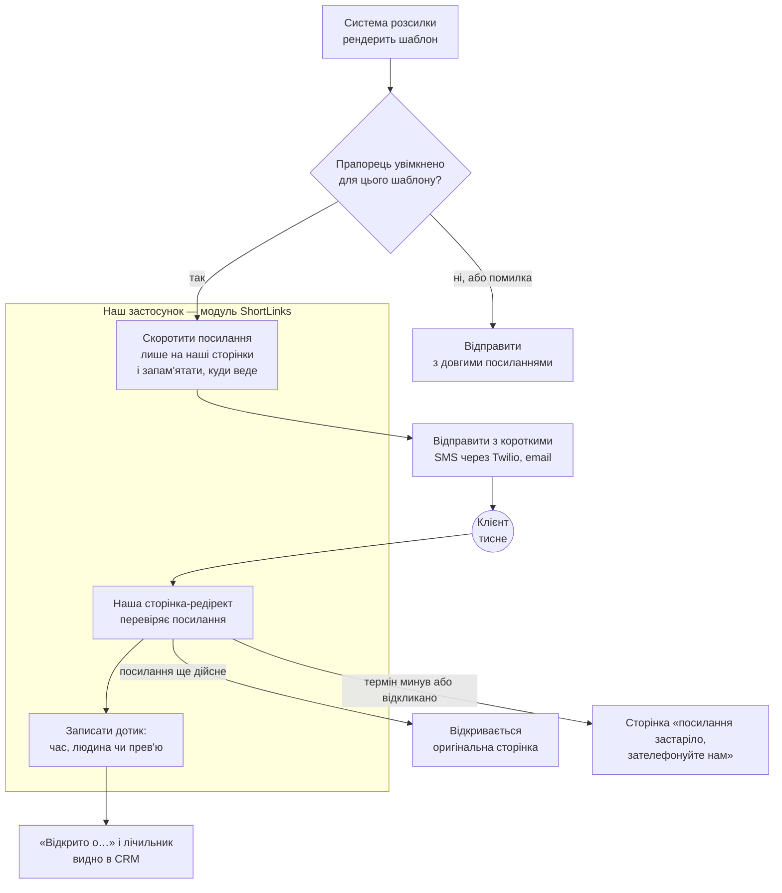

# Скорочувач посилань для вихідних повідомлень

**Пропозиція для команди кол-центру** · Статус: пропозиція · 8 листопада 2026 · Юрій Циквас
Аудиторія: керівник кол-центру (усі розділи; розділ 6 і таблиця годин у розділі 8 — для інженерів). Час читання: 10 хвилин.

*Українська версія пропозиції. Основна — англійська, [`link-shortener.md`](link-shortener.md); у разі розбіжностей діє вона.*

## 1. Коротко

Наші вихідні текстові повідомлення містять посилання на сторінки клієнта (котирування, електронний підпис, оплата, документи). Ці посилання мають 80–150 символів, через що майже кожне повідомлення виштовхується у другий SMS-сегмент, за який ми платимо. Коротке брендоване посилання повертає повідомлення в один сегмент, виглядає надійно і — вперше — показує нам, чи клієнт його відкрив.

**Рекомендація: побудувати як невеликий модуль усередині нашого наявного застосунку**, не як окремий сервіс і не як підписку. Оцінка — **120–200 годин** одного інженера, тобто **$4 800–8 000** за контрактною ставкою $40/год (за американською штатною ставкою $95–190/год множте на 2–4; альтернатива Short.io масштабується так само), плюс **$8–130 на рік** нової інфраструктури (верхня межа — лише якщо нашу SMS-кампанію доведеться перереєструвати), **3–5 тижнів** одного інженера на повний день до живого пілоту, далі 2–4 години на місяць на підтримку. **Окупність:** один–півтора місяця при 20 000 повідомлень на день; 1,2–2,4 року при 1 000 на день, якщо в повідомленні одне посилання. Назвіть нам реальний денний обсяг і частку повідомлень із посиланням — саме ця цифра все вирішує. Альтернатива — Short.io за $1 776 на рік плюс $3 600–6 400 на інтеграцію — коштує приблизно стільки ж за три роки; вона програє в одному, що важливо для страхової: кожен клік клієнта рік зберігатиметься у третьої сторони, а кожне вже відправлене посилання залежатиме від того, чи вендор працює і не змінив ціну.

**Як ми дізнаємось, що спрацювало.** З першого дня пілоту: сегментів і доларів на повідомлення — пілотні шаблони проти решти. Також з першого дня і вперше взагалі: частка посилань, які клієнт справді відкрив.

**Коли перемагає інший вибір.** Якщо ви і Compliance спокійно ставитесь до того, що дані про кліки живуть у вендора, і ніхто не хоче володіти цим сервісом — беріть Short.io: інтеграційна робота та сама, ми її перевикористаємо.

## 2. Проблема

SMS тарифікується за сегмент у 160 символів (153, якщо повідомлення розбите). Токенізоване посилання на сторінку клієнта — 80–150 символів, тож після посилання на сам текст лишається близько 10–80 символів — майже будь-яке формулювання виштовхує повідомлення у два сегменти. Брендоване коротке посилання на кшталт `https://matic.link/Ab3dE9f2` — 27 символів і лишає близько 130 на текст.

| | За сегмент | Повідомлень/день | Зайві сегменти на рік |
|---|---|---|---|
| Twilio US SMS $0,0083 + збір оператора $0,0035–0,0050 | **$0,0118–0,0133** | 1 000 | **$4 300–4 900** |
| | | 20 000 | **$86 000–97 000** |

Припущення: одне посилання на повідомлення; сьогодні повідомлення потребує двох сегментів, з коротким посиланням — одного. Цифри лінійно залежать від частки повідомлень, у яких справді є посилання.

Поза рахунком: 150-символьне посилання з випадкових знаків виглядає як фішингові повідомлення, які клієнтів учать ігнорувати; в email довге посилання лише негарне, а не дороге; і сьогодні ми **не маємо уявлення**, чи хтось відкрив те, що ми надіслали, — повідомлення пішло, і на цьому історія закінчується.

## 3. Що ми припускаємо

**Робочі припущення.** Застосунок працює на Rails 7 або новішому; CRM агентів — частина того самого застосунку (тож «відкрито о…» читається там напряму); система розсилки — конвеєр, що рендерить шаблони і відправляє їх, — зберігає текст повідомлення до скорочення; нашу реєстрацію 10DLC (реєстрацію SMS-кампанії в операторів) можна доповнити новим доменом, інакше нова кампанія триває до п'яти робочих днів. Якщо щось із цього виявиться інакшим, оцінка в розділі 8 зміниться, і ми скажемо про це до старту.

## 4. Варіанти

### 4.1 Використати готовий продукт: Short.io

Ми перевірили двадцять продуктів — вбудоване скорочення SMS-провайдерів, дев'ять SaaS-скорочувачів, дев'ять open-source (ціни прочитані 8 листопада 2026). Підходить один: **Short.io, тариф Enterprise, $148 на місяць** — єдиний опублікований тариф без ліміту на посилання, створені через API, на нашому обсязі. Пропонує пакетне створення, webhook на кожен клік, термін дії посилань, SLA 99,9 %, SOC 2 Type II, угоду про обробку даних і, за запитом, HIPAA business associate agreement.

| Вимір | Оцінка |
|---|---|
| Що отримуєте | Короткі брендовані посилання, «відкрито о…», термін дії, дашборд вендора |
| Чого не отримуєте | Контролю над даними про кліки (IP-адреси зберігаються у вендора рік); незалежності від цін і аптайму вендора для вже відправлених посилань; відкликання — лише через їхній API |
| Вартість | $1 776/рік + інтеграція $3 600–6 400 (90–160 год) + 1–2 год/міс |
| Строк до пілоту | 3–5 тижнів розробки **+ 2–6 тижнів онбордингу вендора** (анкета безпеки, DPA/BAA) |
| Головний ризик | Зміна ціни або відмова вендора ламає кожне посилання у вже відправлених повідомленнях |

Інтеграція не безкоштовна: нашій системі розсилки все одно потрібна та сама робота в місці виклику, що й у варіанті «побудувати», плюс клієнт до їхнього API, приймач їхнього webhook про кліки (без опублікованої схеми чи підпису), локальна таблиця відповідності наших повідомлень їхнім посиланням і задача звірки. Приблизно половина цих годин — робота в системі розсилки, потрібна обом варіантам; тому оцінка «купити» — 90–160 годин, а не тиждень.

**Відкинуто, і чому** (по рядку):

- **Twilio Link Shortening** (вбудоване в нашого SMS-провайдера): $0,015 за повідомлення — *дорожче за сегмент, який воно економить* ($0,012–0,013). На 600 000 повідомлень на місяць це ≈ $9 000 на місяць. Працює лише всередині відправок через Twilio (не email), посилання живуть фіксовані 90 днів, відкликання немає.
- **Bitly**: тарифи самообслуговування закінчуються на 3 000 посилань на місяць; усе потрібне — «Enterprise, зв'яжіться з продажами»; посилання неможливо видалити чи вимкнути.
- **Self-hosted open source (Shlink)**: окремий PHP-сервіс для Rails-команди, відкрите критичне попередження безпеки без вказаної виправленої версії, немає пакетного API. Заощадив би день-два коду і коштував би сервіс, який треба тримати вічно.

### 4.2 Побудувати як модуль у нашому застосунку

Дві таблиці в базі, один внутрішній виклик для системи розсилки, одна публічна сторінка-редірект, одна нічна задача чистки. Працює на тому, що вже є: PostgreSQL, фонові задачі, Kubernetes, Datadog, Sentry, feature flags, Twilio. Єдине нове — короткий домен (≈ $8/рік).

| Вимір | Оцінка |
|---|---|
| Що отримуєте | Усе з 4.1, плюс: дані про кліки лишаються у нас (і ми зберігаємо їх менше — без IP-адрес), посилання можна відкликати, жодних лімітів на посилання, жодної підписки |
| Чого не отримуєте | Аналітичного дашборда вендора; когось іншого, на кого звалити, коли редірект лежить |
| Вартість | $4 800–8 000 розробки (120–200 год із буфером 20 %) + ≈ $8–130/рік + 2–4 год/міс |
| Строк до пілоту | 3–5 тижнів для одного інженера на повний день; домен і 10DLC — паралельно з першого дня |
| Головний ризик | Редірект доступний настільки ж, наскільки доступний наш застосунок: якщо застосунок лежить — відправлені посилання лежать. Прийнятно на нашому обсязі; посилений шлях читання — задокументована друга фаза |

Окрім модуля в застосунку, ми розглянули ще дві форми власного рішення і свідомо відклали обидві.

**Окремий мікросервіс** — власний застосунок зі своєю базою, деплоєм і моніторингом. Він має сенс, коли сервіс потрібен кільком продуктам або має інші вимоги до навантаження, ніж основний застосунок. У нас немає жодної з цих умов: один споживач (система розсилки) і 1–20 тис. посилань на день — приблизно 0,25 запиту на секунду, частка того, що спокійно тримає один екземпляр основного застосунку. Окремий сервіс додав би другий деплой, другу базу, окремий моніторинг і окреме чергування — постійні години підтримки — не додавши жодної можливості, якої не дає модуль. При цьому модуль має чітку межу: якщо колись знадобиться винести його в сервіс, це локальна зміна, а не переписування.

**Edge-редірект** — обробка переходів не в нашому застосунку, а на межі мережі (CDN-воркер, наприклад Cloudflare). Його єдина перевага: короткі посилання працюють, навіть коли основний застосунок лежить. Ціна: новий постачальник і рахунок, копія адрес призначення поза нашою базою у відкритому вигляді (що суперечить нашій політиці даних) і дві системи, які треба тримати синхронними. На нашому обсязі відмова застосунку і так зупиняє відправку повідомлень, тож редірект, який пережив би застосунок, рятував би лише вже відправлені посилання на час інциденту. Для першої версії це прийнятний ризик; фіксуємо як задокументовану наступну фазу.

**Коли повернутись до цього:** приблизно на 100 000 посилань на день (уп'ятеро більше за нашу верхню межу); якщо скорочення знадобиться ще одному продукту; або якщо бізнес вирішить, що редірект має працювати навіть під час відмови основного застосунку.

### 4.3 Порівняння і рекомендація

| | Використати Short.io | **Побудувати (рекомендовано)** |
|---|---|---|
| Рік 1 (побудувати чи інтегрувати + 12 місяців підтримки) | $5 900–9 100 | $5 800–10 100 |
| 3 роки | $10 400–14 600 | $7 700–14 200 |
| Строк до пілоту | 3–5 тижнів + онбординг вендора | 3–5 тижнів |
| Де живуть дані про кліки | У вендора, 1 рік, з IP | У нашій базі, без IP, 13 місяців |
| Хто володіє | Вендор + наш інтеграційний шар | Команда розсилки, 2–4 год/міс |
| Від чого залежать уже відправлені посилання | Аптайм і ціни вендора | Наш застосунок |

За грошима близько — Short.io приблизно на 5 % дешевший у перший рік, «побудувати» приблизно на 13 % дешевше за три роки, і діапазони перекриваються. Вирішують три речі: більшість роботи (інтеграція в систему розсилки, домен, 10DLC, відмова від чужих призначень, статус для CRM) однакова в обох варіантах; дані про кліки наших клієнтів лишаються у нас, і ми зберігаємо їх менше; і ніщо з уже відправленого не залежить від третьої сторони.

## 5. Що буде доставлено

**Для системи.** Коли система розсилки рендерить повідомлення, вона передає посилання і отримує короткі в тому ж порядку за мілісекунди. Якщо те саме повідомлення відправляється повторно — отримує ті самі короткі посилання. Якщо зі скорочувачем будь-яка проблема, повідомлення йде з довгими посиланнями — відправка ніколи не блокується.

**Для клієнта.** Посилання на кшталт `https://matic.link/Ab3dE9f2`. Дотик відкриває оригінальну сторінку. Через 90 днів (або раніше, якщо ми відкликали) клієнт бачить просту сторінку: «Це посилання застаріло. Зателефонуйте нам: …» — англійською та іспанською, текст затверджує Compliance.

**Для вас.** По кожному повідомленню: чи відкрила людина посилання, коли і скільки разів. Автоматичні попередні перегляди месенджерів і сканерів безпеки відсіюються настільки, наскільки це технічно можливо; «відкрито» — сильний сигнал, але не юридичний доказ доставки. Щоденний звіт по шаблонах під час пілоту, з двома списками, на які варто реагувати: посилання, що закінчуються протягом 7 днів і яких так і не відкрили (привід зателефонувати або надіслати повторно, поки посилання живе), і дотики до вже застарілих посилань (клієнт повернувся сам — теплий лід).

| Обсяг | Що входить |
|---|---|
| **Перша версія** | Скорочення з системи розсилки для SMS і email (email вмикається після SMS-пілоту) · редірект · термін дії з людською сторінкою · відкликання (нашими інженерами) · час першого відкриття і лічильник по повідомленню · лише наші призначення · брендований домен · feature flag по шаблону · моніторинг |
| **Друга фаза** (після пілоту, за запитом) | Поле «відкрито о…» в картці клієнта, якщо CRM окрема · автоматичні події в CRM або систему розсилки: «закінчується за 7 днів, не відкрито» і «тицьнули після закінчення» — для дзвінка або нового посилання · правила терміну дії по шаблонах · аналітика понад перше відкриття |
| **Не планується** | QR-коди · власні vanity-посилання · екрани для агентів · редагування призначення після відправки · публічний API для інших продуктів |

## 6. Архітектура

П'ять кроків:

1. **Система розсилки рендерить повідомлення** і, якщо для цього шаблону прапорець увімкнено, передає посилання модулю. Прапорець вимкнено або будь-яка помилка — повідомлення йде з довгими посиланнями; відправка ніколи не блокується.
2. **Модуль скорочує** лише посилання на наші сторінки і зберігає пару: короткий код → призначення (зашифроване).
3. **Повідомлення відправляється** як сьогодні — SMS через Twilio або email — просто з `https://matic.link/…` у тексті.
4. **Клієнт тисне.** Активне посилання перенаправляє (302) на оригінальну сторінку. Застаріле чи відкликане показує просту сторінку «це посилання застаріло, зателефонуйте нам» замість помилки.
5. **Ми записуємо дотик**: час, результат і чи це людина, чи автоматичний перегляд. Перше відкриття людиною і лічильник читаються для CRM.

**Що перевикористовуємо, що нове**

| | Уже є | Нове |
|---|---|---|
| Обчислення, база, задачі | Поди застосунку, PostgreSQL, фонові задачі | 2 таблиці, 1 нічна задача чистки |
| Маршрутизація | Балансир, сертифікати | Короткий домен `matic.link` (≈ $8/рік), DNS, сертифікат, одне правило маршрутизації |
| Спостережуваність | Datadog, Sentry | 1 синтетична перевірка, 3 алерти, 1 дашборд |
| Реліз | Feature flags | 1 прапорець на створення посилань (редірект ніколи не під прапорцем) |
| Розсилка | Twilio Messaging Service, шаблони | Можливо, нова 10DLC-кампанія з доменом у зразках |
| Свідомо не зараз | — | Окремий сервіс, окрема база, кеш, edge-редірект |

**Дані й приватність**

| Зберігаємо | Не зберігаємо | Скільки |
|---|---|---|
| Короткий код, призначення (зашифроване — воно містить токен клієнта, і будь-хто, хто читає таблицю, інакше міг би відкрити його сторінку), посилання на повідомлення, шаблон, термін дії, відкликання | IP-адресу, пристрій, браузер, місцезнаходження, referrer | Призначення стирається через 7 днів після закінчення терміну; події кліків — 13 місяців; запис посилання і лічильники лишаються |
| По кліку: час, результат (відкрито / застаріло / відкликано), людина чи автоматичний перегляд | Будь-що, що ідентифікує клієнта понад посилання на повідомлення | — |

Редірект використовує тимчасовий статус (302), тож браузери його ніколи не кешують, а відкликання спрацьовує одразу.

## 7. План розгортання

| Фаза | Що відбувається | Критерій виходу |
|---|---|---|
| **Тиждень 0 — паралельно** | Зареєструвати домен; розпочати зміну 10DLC-кампанії; погодити з Compliance текст сторінки «застаріло» і політику даних | Домен працює, кампанія подана |
| **Тижні 1–4 — розробка** | Модуль, тести, моніторинг; staging | Викочено в production **за вимкненим feature flag** (перемикач, який ми клацаємо без релізу); один звичайний реліз проходить із невикористаним модулем |
| **Тижні 5–6 — пілот** | Прапорець увімкнено для **1–2 SMS-шаблонів**. Порівнюємо з рештою: сегментів і $ на повідомлення, частка посилань, відкритих людиною, медіанний час до першого відкриття, частка недоставлених | Пілотні шаблони ≈ 1 сегмент на повідомлення проти ≈ 2 у решти; без погіршення доставлюваності; кол-центр задоволений сигналом «відкрито» |
| **Тиждень 7 — усі SMS** | Прапорець для всіх SMS-шаблонів | Два стабільні тижні |
| **Тиждень 8+** | Email-шаблони, з вимкненим трекінгом кліків поштового провайдера для наших посилань; пункти другої фази за запитом | — |

**Як вимкнути.** Клацнути прапорець — повідомлення підуть із довгими посиланнями за хвилину. Уже відправлені посилання працюють далі: редірект не залежить від прапорця. **Якщо оператори почнуть фільтрувати наш домен** (частку недоставлених дивимось щодня): прапорець вимкнути того ж дня, далі новий домен і нова кампанія (1–2 тижні).

## 8. Вартість і строки

Ставка: **$40/год** (senior контрактний інженер, Східна Європа). Підставте свою; години — стабільна частина.

| Побудувати — робота | Годин |
|---|---|
| Ядро модуля: таблиці, коди посилань, список дозволених призначень, виклик скорочення, редірект, запис кліків, сторінка «застаріло», відкликання, чистка, адаптер для конвеєра, прапорець, метрики, захист від перебору | 36–56 |
| Перевірки дня 0 та **інтеграція в конвеєр системи розсилки** + метрики сегментів/ціни | 22–44 |
| Інфраструктура: домен, маршрутизація, сертифікат, монітори, 10DLC, staging | 15–27 |
| Ревю коду командою-власником, текст сторінки «застаріло» з Compliance, runbook, раунди ревю, smoke-тести | 20–30 |
| Передача, документація, чекліст безпеки, резервна копія ключів | 7–10 |
| **Разом** | **100–167** |
| **З буфером 20 %** | **120–200 год → $4 800–8 000** |

Свідомо консервативно: оцінка включає години на ревю, compliance і передачу, які перші оцінки зазвичай пропускають. Найширший пункт — інтеграція в систему розсилки, код якої ми ще не читали.

Постійно: 2–4 год/міс ($1 000–1 900/рік) і $8–130/рік інфраструктури. Календар: 120–200 годин — це 3–5 тижнів одного інженера на повний день до пілоту; 10DLC і Compliance — паралельно з першого дня.

| Купити (Short.io) — для порівняння | |
|---|---|
| Інтеграція (клієнт API, приймач webhook, таблиця відповідності, звірка, онбординг вендора, ревю) | 75–133 год → з буфером 90–160 год → $3 600–6 400 |
| Підписка | $1 776/рік |
| Постійно | 1–2 год/міс |
| Календар | 3–5 тижнів + 2–6 тижнів онбордингу вендора |

Найменш певний пункт в обох стовпцях — ця інтеграція (14–30 год).

## 9. Ризики і рішення за замовчуванням

| Ризик | Імовірність / вплив | Що робимо |
|---|---|---|
| Оператори фільтрують повідомлення з новим доменом | Низька / високий | Щодня дивимось частку недоставлених під час пілоту; прапорець вимкнути того ж дня; новий домен + кампанія за 1–2 тижні. Публічні скорочувачі (bit.ly, tinyurl) оператори відхиляють одразу — брендований домен потрібен в **обох** варіантах |
| Зміна 10DLC-кампанії триває довше за п'ять робочих днів | Середня / середній | Починаємо в день 0; модуль викочується незалежно і чекає за прапорцем |
| Посилань у повідомленнях менше, ніж припускали | Середня / середній | Економія масштабується з часткою; читаємо реальну частку з даних розсилки на тижні 0 і перераховуємо окупність до старту |
| Відмова застосунку кладе редірект | Низька / середній | Та сама доступність, що й у всього, що ми запускаємо; посилений шлях читання — задокументована пізніша фаза |
| «Відкрито» зараховано автоматичному перегляду | Середня / низький | Фільтруємо за ознаками браузера; подаємо як оцінку, ніколи як доказ |

**Рішення, з якими будуємо**

1. **Якщо скорочувач відмовив, повідомлення йде з довгим посиланням.** Доставлене повідомлення важливіше за заощаджений сегмент; ми отримуємо алерт.
2. **Email скорочуємо теж**, вмикаємо після SMS-пілоту. Трекінг кліків поштового провайдера для наших посилань вимикаємо, щоб журнал відкриттів був один для SMS і email.
3. **Посилання живуть 90 днів за замовчуванням**; коротші терміни по шаблонах (наприклад, для платіжних посилань) задаються за потреби.
4. **Фіксуємо лише те, чи відкрила людина посилання, коли і скільки разів — і нічого більше.** Без IP-адрес, пристроїв і місцезнаходження; події кліків зберігаємо 13 місяців; призначення стираємо через 7 днів після закінчення терміну (деталі в розділі 6).
5. **Скорочуємо лише посилання на наші сторінки.** Усе інше лишається довгим, тож домен не можна використати, щоб замаскувати чужий сайт.
